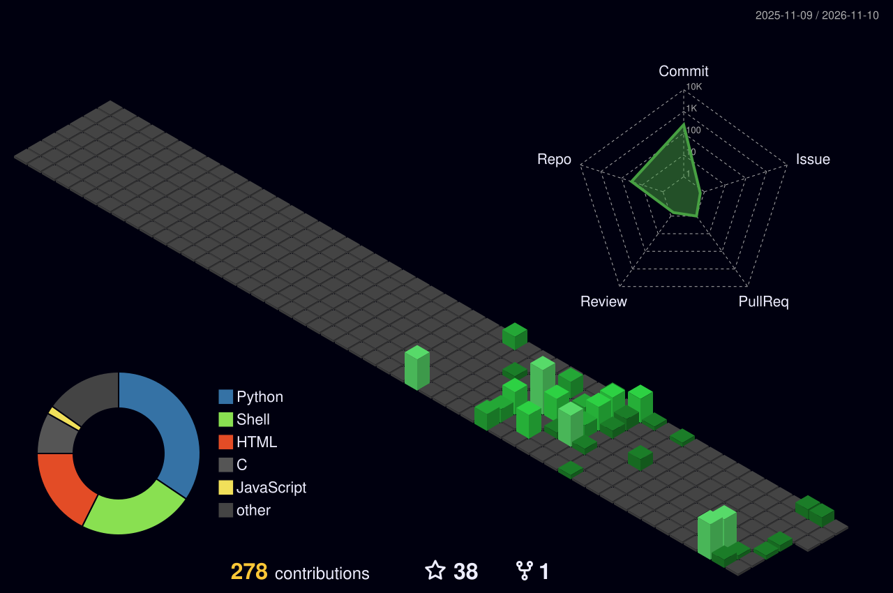

<div align="center">


</div>

<p align="center">
  
  &nbsp;
  
  &nbsp;
  
</p>

<br>

<p align="center">
  
</p>

<br>

```
┌─[venu@kali]─[~]
├── $ whoami
│   → security researcher · bug bounty hunter · arch + kali · tiruvannamalai, india
│
├── $ ls ~/arsenal/
│   → vanta/            # pentest & bug-bounty framework (scope guard, ATT&CK mapping)
│   → Beast/            # pure-C multi-threaded recon — DNS, ports, TLS, headers
│   → assetmap/         # fingerprinting: favicon hash, crt.sh, SSL, header audit
│   → full-recon/       # recon pipeline: subfinder → httpx → waybackurls → nmap → nuclei
│   → JSScope/          # JS endpoint / secret / GraphQL schema extractor
│   → APIFlowHunter/    # OpenAPI / Postman / Swagger + JS endpoint mapper
│   → idor_prober/      # API IDOR probing
│   → httpfuzz/         # lightweight C HTTP fuzzer
│   → takeoverhunter/   # subdomain takeover detector (~45 services)
│   → payloadforge/     # payload generator + mutator, WAF-bypass variants
│   → vulnradar/        # terminal TUI mission control for bounty hunting
│   → s3-toolkit/       # S3 bucket misconfig enumeration
│   → WebTrap/          # web honeypot that logs malicious scanning
│   → Portscanner/      # multi-threaded TCP port scanner
│   → ssh-bruteforce/   # SSH auth testing (paramiko)
│   → keylogger/        # input monitoring (educational, pynput)
│
├── $ cat /etc/targets
│   → HackerOne · Bugcrowd · Web Apps · APIs
│
└── $ echo $STATUS
    → hunting bugs · writing exploits · automating recon
```

<br>

## 🔥 Now

- 🎯 Final-year project: **[takeoverhunter](https://github.com/Venu-exe/takeoverhunter)** — subdomain takeover detector
- 📡 New: **[vulnradar](https://github.com/Venu-exe/vulnradar)** — terminal mission control for hunters (curses TUI)
- 🔍 Hunting web apps, APIs, cloud & subdomain takeover on HackerOne & Bugcrowd

<br>


<br>

## 📡 Connect

<p align="center">
  <a href="https://hackerone.com/venu-sh?type=user"></a>
  &nbsp;
  <a href="https://bugcrowd.com/h/venu-sh"></a>
  &nbsp;
  <a href="https://github.com/Venu-exe"></a>
  &nbsp;
  <a href="https://venu-exe.github.io/"></a>
</p>

<p align="center">
  <b>Open to:</b> collaboration · bug bounty team-ups · open-source security contributions
</p>

<br>


<br>

## 🏆 Bug Bounty & Responsible Disclosure

<p align="center">
  
  &nbsp;
  
  &nbsp;
  
</p>

<!-- TODO: replace these placeholder percentages with your real severity mix -->
<div align="center">

| Severity | Mix |
|:--:|:--|
| 🔴 Critical |  |
| 🟠 High |  |
| 🟡 Medium |  |
| 🔵 Low |  |
| ⚪ Informational |  |

</div>

> 🏅 **Hall of fame:** HackerOne · Bugcrowd — every finding reported through responsible disclosure. No harm, just protection.
<!-- TODO: add resolved programs / acknowledgements here -->

<br>


<br>

## ❄️ What I'm Up To

<table>
<tr>
<td>

```yaml
offensive_tooling:
  python:
    - vanta            # pentest & bounty framework
    - JSScope          # JS endpoint/secret extraction
    - payloadforge     # payload generator + WAF bypass
    - vulnradar        # terminal bounty TUI
    - takeoverhunter   # subdomain takeover detection
    - Portscanner      # raw socket scanning
    - ssh-bruteforce   # paramiko + threading
    - keylogger        # pynput keystroke capture
  c:
    - Beast            # multi-threaded recon toolkit
    - assetmap         # fingerprinting + TLS/header audit
    - APIFlowHunter    # API endpoint mapping
    - idor_prober      # IDOR probing
    - httpfuzz         # HTTP fuzzer
  bash:
    - full-recon       # subfinder → httpx → waybackurls → nmap → nuclei
    - s3-toolkit       # bucket misconfig enumeration

current_focus:
  - 🎯 Web app & API bug bounty on HackerOne / Bugcrowd
  - 🧰 Building offensive tooling in Python & C
  - 🔗 Chaining recon into automated pipelines
  - 🕵️ OSINT & subdomain enumeration at scale
  - 📡 Leveling up in SOC & threat analysis
  - 🔴 Studying red team fundamentals

platforms:
  hackerone: venu-sh
  bugcrowd: venu-sh
  portfolio: venu-exe.github.io

philosophy: >
  Break it, report it, fix it.
  No harm — just protection.
```

</td>
</tr>
</table>

<br>


<br>

## 🧊 Arsenal

<p align="center">
  
</p>

<br>

<div align="center">

| Domain | Skill | Level |
|:--:|:--|:--|
| 🐍 | **Python Offensive Tooling** |  |
| ⚙️ | **C / Systems Programming** |  |
| 🌐 | **Web App Security** |  |
| 🧬 | **API Security (OWASP API Top 10)** |  |
| 📜 | **Bash / Shell Automation** |  |
| 🔍 | **Recon & OSINT** |  |
| 🔗 | **Tool Chaining & Pipelines** |  |
| 🎯 | **Bug Bounty Methodology** |  |
| 🌍 | **Networking & Port Scanning** |  |
| 🛡️ | **SOC & Threat Intel** |  `learning` |
| 🔴 | **Red Teaming** |  `learning` |

</div>

<br>


<br>

## 🛠️ Featured Repos

<div align="center">

<a href="https://github.com/Venu-exe/JSScope">
  
</a>
&nbsp;
<a href="https://github.com/Venu-exe/vanta">
  
</a>

<br>

<a href="https://github.com/Venu-exe/Beast">
  
</a>
&nbsp;
<a href="https://github.com/Venu-exe/full-recon">
  
</a>

<br>

<a href="https://github.com/Venu-exe/takeoverhunter">
  
</a>
&nbsp;
<a href="https://github.com/Venu-exe/payloadforge">
  
</a>

</div>

<br>

## 📁 Project Index

| Project | Stack | What it does |
|:--|:--:|:--|
| [vanta](https://github.com/Venu-exe/vanta) | 🐍 Python | Red-team-minded pentest & bug-bounty framework — scope guard that fails closed, ATT&CK mapping, hash-chained evidence custody |
| [Beast](https://github.com/Venu-exe/Beast) | ⚙️ C | Fast multi-threaded recon toolkit — DNS, ports, subdomains, TLS, security headers. Single binary |
| [assetmap](https://github.com/Venu-exe/assetmap) | ⚙️ C | Recon & fingerprinting — favicon hash, crt.sh, SSL fingerprint, header audit, TLS vuln scanner |
| [full-recon](https://github.com/Venu-exe/full-recon) | 🐚 Shell | One-command recon pipeline: subfinder → httpx → waybackurls → nmap → nuclei |
| [JSScope](https://github.com/Venu-exe/JSScope) | 🐍 Python | Scans JS files for exposed API endpoints, secrets & GraphQL schemas |
| [APIFlowHunter](https://github.com/Venu-exe/APIFlowHunter) | ⚙️ C | Maps API endpoints from OpenAPI/Postman/Swagger specs + JS/GraphQL for IDOR & API testing |
| [takeoverhunter](https://github.com/Venu-exe/takeoverhunter) | 🐍 Python | Zero-dependency subdomain takeover detector — DNS + HTTP fingerprinting vs ~45 services |
| [payloadforge](https://github.com/Venu-exe/payloadforge) | 🐍 Python | Payload generator & mutator — 7 vuln types, 6 encodings, WAF-bypass variants |
| [vulnradar](https://github.com/Venu-exe/vulnradar) | 🐍 Python | Terminal TUI mission control — radar, targets, findings, loot tracker |
| [bountyreport](https://github.com/Venu-exe/bountyreport) | 🐍 Python | Report generator — CVSS 3.1 calculator, 27 vuln templates, 5 platform formats |
| [idor_prober](https://github.com/Venu-exe/idor_prober) | ⚙️ C | Probes API endpoints for Insecure Direct Object Reference (IDOR) |
| [bountycommand](https://github.com/Venu-exe/bountycommand) | 🟨 JS | All-in-one bug bounty command center — targets, findings, payload lab, CVSS, report gen (offline) |
| [bountyrecon](https://github.com/Venu-exe/bountyrecon) | 🐍 Python | All-in-one zero-dependency recon toolkit |
| [s3-toolkit](https://github.com/Venu-exe/s3-toolkit) | 🐚 Shell | Enumerates S3 buckets for public access & misconfigurations |

<br>


<br>

## 🗺️ Learning Roadmap

<div align="center">

| ✅ Learned | 🔄 In Progress | 📋 On The List |
|:--|:--|:--|
| Python & scripting | Web app & API security (OWASP Top 10) | eJPT → OSCP path |
| Bash & automation | Burp Suite pro workflow | Cloud security (AWS / Azure) |
| Linux / Kali | SOC & threat intelligence | Active Directory attacks |
| Networking & TCP/IP | Red team fundamentals | Mobile app pentesting |
| Git & GitHub | C for offensive tooling | Detection engineering |
| Web fundamentals (HTML/JS) | Bug bounty methodology at scale | Malware analysis basics |
| picoCTF — crypto basics | | Bug bounty report writing |

</div>

<br>


<br>

## 📊 Stats

<p align="center">
  
  &nbsp;
  
</p>

<p align="center">
  
</p>

<p align="center">
  
</p>

<p align="center">
  
</p>

<br>


<br>

## 🐍 Contribution Snake

<p align="center">
  
</p>

<br>

## 🧊 3D Contribution Graph

<p align="center">
  
</p>

<br>


<br>

<div align="center">

```
[●] status   : hunting
[●] focus    : subdomain takeover · API security · recon automation
[●] shipping : takeoverhunter (final-year project)
[○] sleep    : optional
```

</div>

<br>

<div align="center">

```
 ╔══════════════════════════════════════════════════════════════╗
 ║                                                              ║
 ║   "The quieter you become, the more you are able to hear."   ║
 ║                                        — Kali Linux          ║
 ║                                                              ║
 ╚══════════════════════════════════════════════════════════════╝
```

</div>

<br>


<p align="center">
  
</p>
